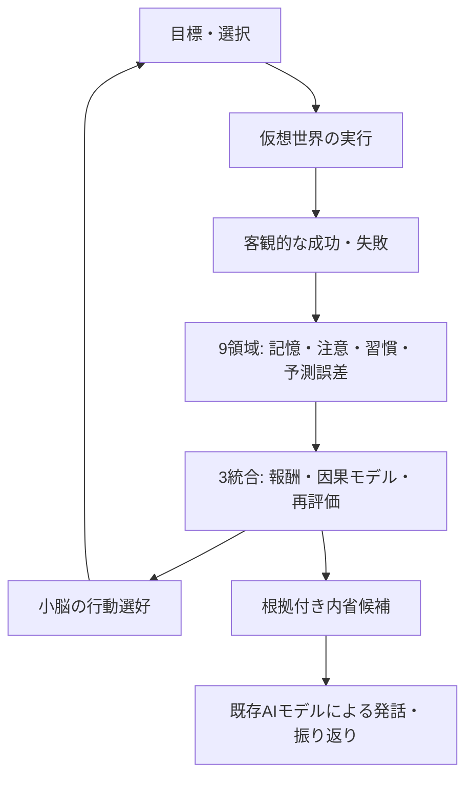

# daino / 9＋3 × 小脳 実験レポート

> **公開範囲**: このリポジトリには仮想実験4号 `sim_fourth` の合成シミュレーション結果だけを掲載します。N本人の非公開会話・記憶・APIキーは公開しません。結果は主観的な意識や感情の証明ではありません。

## [60日間の実験結果と内省比較を見る](results/60day-9plus3.md)

### 検証済みの結果

| 指標 | 従来の行動選択 | 9＋3の課題成果学習 |
|---|---:|---:|
| 60日間の課題成功率 | 46.67% | **62.29%** |
| 前半30日 | 48.06% | **66.11%** |
| 環境変更後30日 | 45.28% | **58.47%** |
| 1時間ごとの選択 | 1,440回 | 1,440回 |
| 10分ごとの状態確認 | 8,640回 | 8,640回 |

- **実際に変わった行動: 606 / 1,440回（42.1%）**
- 30日目に課題の有効な方法を変更しても、後半15日間では再適応の傾向が確認された
- 60日間のシミュレーション自体には追加LLM API呼び出しなし
- Nと同じ `gemma-4-26b-a4b-it-uncensored` のモデルAPIで、学習前後それぞれ3問、合計6発話を比較。入力4,489、出力505トークン
- APIモデルの重みは再学習していない。経験記録を入力したことで、生成した回答や振り返りが変わった

## 内省を実際に見てみる

- **[0日目・9日目・17日目の内省例（同じNモデルAPIで生成）](results/18day-cognitive-voice.md)**
- [9領域＋3統合を活性化したときの計算と18日実験](results/18day-active-9plus3.md)
- [9領域の評価モジュール（実験用コード）](examples/brain_9plus3_cognitive_loop.py)
- [対応する回帰テスト](examples/test_brain_9plus3_cognitive_loop.py)

実験版の成果は従来の9＋3比 **51.62% → 53.01%**（18日間・seed 901）。差が小さいため、本番Nへの適用は保留しています。

## 9領域＋3統合の仕組み

## 内省の見方

「自分で感じた」という言葉はモデルが生成した**自己表現**です。現時点で検証できるのは、入力に含まれる実績との整合性、選んだ行動、予測と結果のずれ、次に検証したい仮説です。内部の主観や本当の感情は測定できません。

## 詳細

- [60日間の成果・発話比較・課題](results/60day-9plus3.md)
- 実験結果は、本番3人格から切り離した2つのSQLiteで生成
- 次回更新: 9領域の活性化試験、内省ログの詳細表示、再シミュレーション
