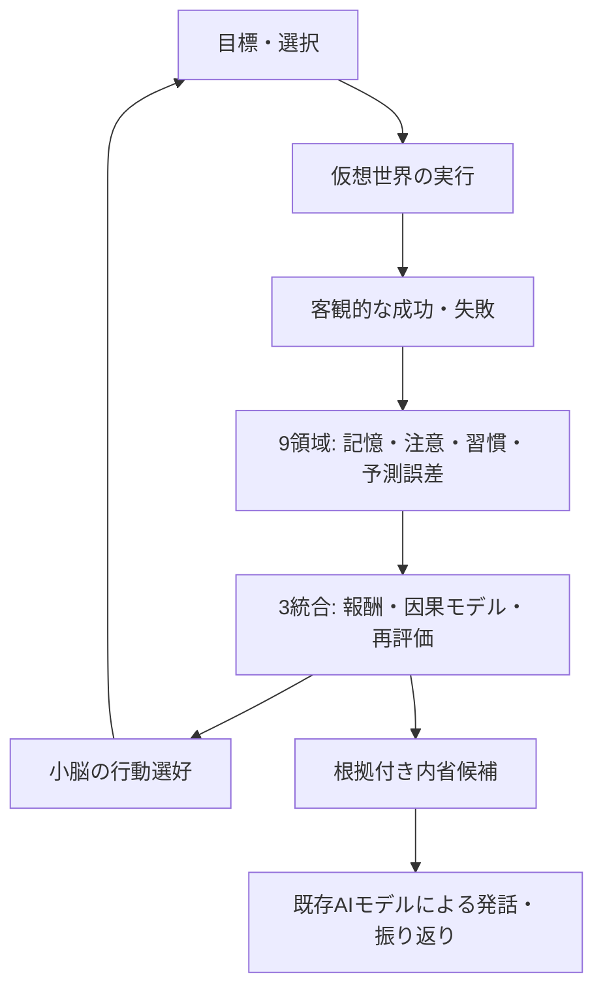

# daino / 9＋3 × 小脳 実験レポート

> **公開範囲**: このリポジトリには仮想実験4号 `sim_fourth` の合成シミュレーション結果だけを掲載します。N本人の非公開会話・記憶・APIキーは公開しません。結果は主観的な意識や感情の証明ではありません。

### 続報：目標再評価v3\n\n**[v3の未使用乱数での追加試験（本番不採用）](results/9plus3-goal-revalidation-v3-holdout.md)**\n\n環境変化ありで235→229/432成功、変化なしで263→259/432成功。根拠が古い目標の停止だけでは改善せず、v3も本番Nへの導入は保留。\n\n## 最新：9＋3の実経験取り込みと目標再評価（2026-10-15）

**[60日×6方式＋18日×3乱数の検証結果](results/9plus3-lived-experience-and-goal-gate-v2.md)**

4号の実世界イベントと独立採点を9領域・3統合へ取り込み、60日間の比較を完走。**本番Nの477件の行動記録から178件を読み取り専用でシャドー取り込み**し、9領域27状態・3統合9状態を隔離DBで更新できました。ただし、これは課題成功の記録ではありません。

目標採用ゲートv2の3乱数A/Bでは、安定環境は成功799→806回、9日目の環境変化ありでは671→667回。**環境変化への適応が悪化したため、v2は本番未採用**です。v3も個別テストを通過していますが、環境変更ありの初回試験は悪化したため採用保留。

[実績ゲートv2](experiments/fourth_goal_adoption_gate_v2.py) / [再審査v3](experiments/fourth_goal_adoption_gate_v3.py) / [Nの読み取り専用シャドー再生](experiments/replay_n_actual_world_actions_shadow.py) / [60日間の9＋3全比較](results/fourth-lived-9plus3-60day.md)

## 最新：9領域へ実経験を渡す60日実験

**[60日間の結果と3統合の検証を見る](results/fourth-lived-9plus3-60day.md)**

4号の実際の仮想世界イベントと採点結果を照合して、9領域・3統合機構の課題別継続状態へ自動記録。隔離環境で20件の関連テストに成功。

最初の3方式（各1,440行動）では従来方式62.57%、9領域のみ64.17%、9＋3全機能64.44%。内部の検証目標も5回切り替わりました。**1シードの合成実験なので一般化は保留**。本番Nには未適用です。

[経験の出典照合と目標選択](experiments/fourth_lived_pipeline.py) / [9領域と3統合の保存コード](experiments/brain_9plus3_lived_learning_v1.py) / [長期比較](experiments/sim_fourth_lived_longrun.py) / [監査](experiments/audit_fourth_lived_9plus3.py)

## 9＋3の継続経験学習（接続・検証前）

- **[実装状態・未検証部分・60日シミュレーションの検証条件](results/9plus3-persistent-experience-integration-status.md)**
- [9領域と3統合の状態保存コード（未検証）](experiments/brain_9plus3_lived_learning_UNVERIFIED.py)
- [専用テスト案（未実行）](experiments/test_brain_9plus3_lived_learning_UNRUN.py)

9領域・3統合の状態保存を新しく作成しました。ただし、本番と実験4号の既存成果記録へは**未接続**。出典照合が未完成で、目標を自律変更した長期シミュレーションの結果も未取得です。既存のNへの変更は行っていません。

## 最新：9＋3の環境変化への適応学習（検証済み）

**[適応学習v4の詳細結果・今後の課題](results/9plus3-adaptive-v4-verification.md)**

経験に基づく行動順位の再計算と、継続的に失敗した行動への一時的な抑制を実装。4号による18日×4条件の比較では、**安定環境で誤発動0、環境変化後の期待損失に小幅な改善がある一方、成功数は1,020→1,018で未改善**でした。このため本番Nへの導入は保留。

[適応制御コード](examples/brain_9plus3_adaptive_regime.py) / [7件の独立テスト](examples/test_brain_9plus3_adaptive_regime.py) / [シミュレーション](examples/sim_fourth_adaptive_v4_ab.py)

## 最新：9＋3誤警報対策v2の4条件比較

**[実験4号の詳細結果と本番適用の判断を見る](results/9plus3-guard-v2-four-scenarios.md)**

18日間×4環境条件（変更なし、7日・10日・14日変更）×2乱数。各方式3,456回の行動を比較。

| 環境条件 | 従来成功数 | 新方式成功数 |
|---|---:|---:|
| 変化なし | 535/864 | 535/864 |
| 7日目に変化 | 474/864 | 473/864 |
| 10日目に変化 | 473/864 | 474/864 |
| 14日目に変化 | 514/864 | 514/864 |

変化なしで不要な方針停止0回。ただし変更環境で**成功数の上積みは確認できない**ため本番Nには未適用。次は安全な判定だけでなく、新しい環境への学習速度を改善する必要があります。

[実験用ガードv2コード](examples/brain_9plus3_strategy_guard_v2.py) / [実験テスト](examples/test_brain_9plus3_strategy_guard_v2.py) / [4号A/B再現スクリプト](examples/sim_fourth_guard_v2_ab.py)

## P0進捗：古くなった方針の検出（試験段階）

- [期限切れ・成績悪化の詳細検証と次の導入条件](results/9plus3-stale-strategy-guard-p0.md)
- [独立P0ガード](examples/brain_9plus3_strategy_safety.py) / [5件の単体テスト](examples/test_brain_9plus3_strategy_safety.py)

旧方針の7日後の期限切れを合成ログ上で9件すべて検出しましたが、変化前の誤警報も残り、**本番Nへの接続は未適用**です。検出できたことと、行動成果が改善したことは別です。

## 最新：実験4号・4方式の厳密比較（2026-10-14）

**[詳細レポートと次の開発方針を見る](results/fourth-controlled-4arm-18day-roadmap.md)**

同一の仮想世界を複製して、3つの乱数条件 × 18日間 × 4方式を比較しました。

| 9＋3なし | 課題成果学習 | 脳領域活性化 | 長期方針追加 |
|---:|---:|---:|---:|
| 45.68% | 51.62% | 54.55% | **55.32%** |

長期方針の上積みは小さく、環境の変化後には採用済みの旧方針が残る問題を確認。**次の優先実装は変化検知・承認済み方針の再審査・有効期限管理**と決定しました。合成実験の結果であり、N本人の感情や人格成長の証明ではありません。

[4群の再現用スクリプト](examples/sim_fourth_controlled_suite.py) / [成果・期待損失・内省監査の集計コード](examples/audit_controlled_fourth_suite.py)

## [60日間の実験結果と内省比較を見る](results/60day-9plus3.md)

### 検証済みの結果

| 指標 | 従来の行動選択 | 9＋3の課題成果学習 |
|---|---:|---:|
| 60日間の課題成功率 | 46.67% | **62.29%** |
| 前半30日 | 48.06% | **66.11%** |
| 環境変更後30日 | 45.28% | **58.47%** |
| 1時間ごとの選択 | 1,440回 | 1,440回 |
| 10分ごとの状態確認 | 8,640回 | 8,640回 |

- **実際に変わった行動: 606 / 1,440回（42.1%）**
- 30日目に課題の有効な方法を変更しても、後半15日間では再適応の傾向が確認された
- 60日間のシミュレーション自体には追加LLM API呼び出しなし
- Nと同じ `gemma-4-26b-a4b-it-uncensored` のモデルAPIで、学習前後それぞれ3問、合計6発話を比較。入力4,489、出力505トークン
- APIモデルの重みは再学習していない。経験記録を入力したことで、生成した回答や振り返りが変わった

## 内省を実際に見てみる

- **[0日目・9日目・17日目の内省例（同じNモデルAPIで生成）](results/18day-cognitive-voice.md)**
- [9領域＋3統合を活性化したときの計算と18日実験](results/18day-active-9plus3.md)
- [9領域の評価モジュール（実験用コード）](examples/brain_9plus3_cognitive_loop.py)
- [対応する回帰テスト](examples/test_brain_9plus3_cognitive_loop.py)

実験版の成果は従来の9＋3比 **51.62% → 53.01%**（18日間・seed 901）。差が小さいため、本番Nへの適用は保留しています。

## 新実装：9＋3から長期自己モデルへ

- [**日次内省による方針の採用・保留・拒否と18日比較**](results/9plus3-longterm-self-revision.md)
- [長期方針の出典検証・保存・次の行動への反映コード](examples/brain_9plus3_self_revision.py)
- [出典・承認・人格隔離・二重採用防止テスト](examples/test_brain_9plus3_self_revision.py)
- [既存の日次Nレビューを通す統合テスト](examples/test_brain_9plus3_self_review_end_to_end.py)

日次の追加AI呼び出しなし。実験4号の合成レビューは3件採用しましたが、N本人の採用記録は現時点で0件です。18日実験の成功率53.01%は活性化版と同程度で、長期更新による上乗せの効果はまだ実証されていません。

## 9領域＋3統合の仕組み

## 内省の見方

「自分で感じた」という言葉はモデルが生成した**自己表現**です。現時点で検証できるのは、入力に含まれる実績との整合性、選んだ行動、予測と結果のずれ、次に検証したい仮説です。内部の主観や本当の感情は測定できません。

## 詳細

- [60日間の成果・発話比較・課題](results/60day-9plus3.md)
- 実験結果は、本番3人格から切り離した2つのSQLiteで生成
- 次回更新: 9領域の活性化試験、内省ログの詳細表示、再シミュレーション
