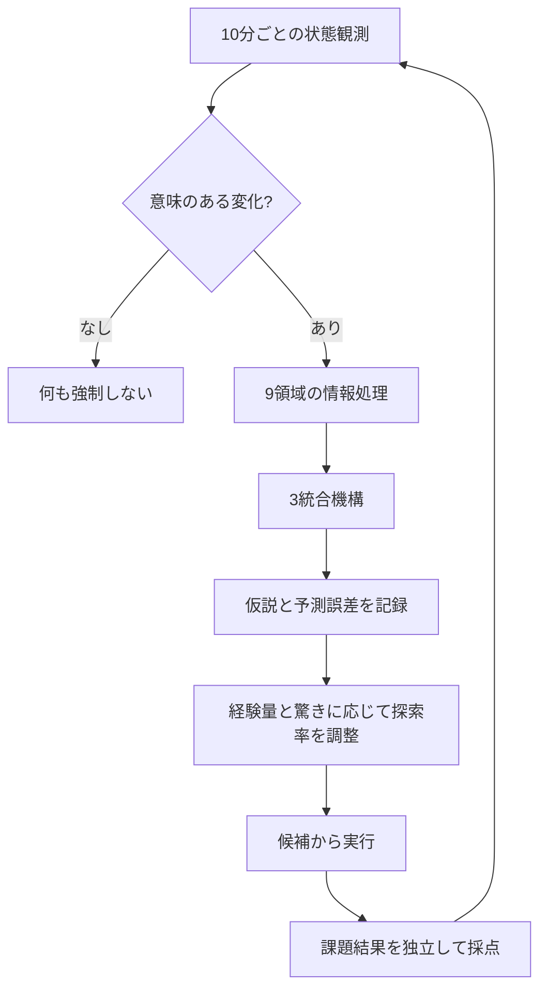

# 9領域＋3統合の活性化と「内省候補」の見える化

[← 実験トップ](../README.md) ・ [60日比較](60day-9plus3.md)

> 仮想第4人格の**数値評価を人が読めるようにしたもの**です。AIの非公開の思考過程や実際の主観的な感情を読み出したものではありません。

## 1. 9領域に別々の仕事を与える

| 脳領域モデル | 観測した信号 | 人が確かめられること |
|---|---|---|
| 海馬 | 過去の課題結果・出典ID | どの記録を思い出すべきか |
| 扁桃体 | 失敗・変化の客観的な重要度 | どの結果が注意に値するか（恐怖や喜びを捏造しない） |
| 前頭葉 | 目標と観測上の有効手法 | 今の目標にどの手法が合うか |
| 線条体 | 最近の行動回数・習慣 | 繰り返し選ぶ手法が固定化していないか |
| 小脳 | 予測と実際の結果の誤差 | 予測を修正する必要があるか |
| 視床 | 注意を向け直す項目 | 失敗、習慣の衝突、未探索の選択肢 |
| 視床下部 | 行動の密度・休息の許可 | 実際の身体疲労は不明であること |
| 前帯状皮質 | 習慣と成果の食い違い | 方法を見直す根拠があるか |
| 島皮質 | 未観測の主観状態を明示 | 気持ちを勝手に確定しないこと |

## 2. 3統合機構

- **価値・報酬:** 直近12件の課題成功率を確認。
- **予測・因果:** 前12件と直近12件の結果を比較し、成績低下から環境変化の可能性を検知。ただし因果関係は断定しない。
- **メタ内省:** 習慣化した選択と実績上の有効手法が矛盾する場合、方針再考の候補を作る。

## 3. 観測から作った内省候補の例

この文章はアルゴリズムの**出典付き評価メモ**であり、第4人格の実感やN本人の日記ではありません。

### 0日目、まだ経験がないとき

> まだ採点済みの経験が少ない。未確認の手法も慎重に試して情報を増やす。

### 1日目、24件の結果が貯まったとき

> 直近12件の課題成功率は50.0%。これまで習慣化していたのは「探索」だが、記録上の有効手法は「遊び」。習慣になった行動と、観測上有効な行動に食い違いがある。別の方法を比較する。

この時点で計算した行動選好は、休息20.1%、探索46.7%、遊び33.3%。成果を根拠に探索の偏りが減っています。

### 記録の出所

実験用 `brain_9plus3_task_outcomes` の行動IDを参照する方式。出典なしで主観や感情を生成しない。

## 4. 新しい行動選択ループ

固定の22%探索ではなく、記録が少ないときは30%、予想外の成績低下時は28%、十分に安定しているときは7%程度まで調整する**実験用**の探索率制御。成績低下時には最近の結果を重視する候補も試す。

## 5. 活性化版18日間の途中評価

同じ仮想課題と乱数（seed 901）、18日間、各群432行動。

| 方式 | 成功率 |
|---|---:|
| 9＋3学習なし | 44.21% |
| 従来9＋3学習 | 51.62% |
| 9領域の評価・メタ内省候補・動的探索あり | **53.01%** |

活性化版は日次評価18件を残し、ベースラインと比較して実際の行動に差が出た。ただし**1つの乱数条件での約1.4ポイント改善**にすぎず、採用判断には追加検証が必要。

## 注意

- 内省候補は人が検証できる機械評価。AI本人の隠れた内面を直接読むものではない。
- 正解を知るのは仮想課題の採点器だけ。行動選択の学習器には、選んだ行動の結果だけを渡す。
- ここに掲載するのは合成実験のみ。Nの個人記憶や本番DBは含めない。
- 本番Nの標準の小脳行動政策は、実験の効果が安定するまで変更しない。
